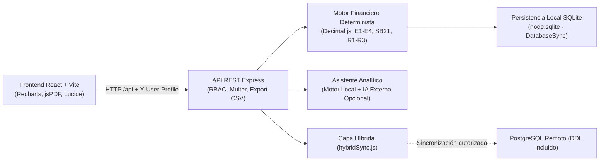

# Plataforma Inteligente de Rankings y Análisis Bancario — Hackathon SBP 2026

Plataforma web híbrida, determinista y automatizada para el procesamiento de archivos **AT03**, validación de calidad de datos, cálculo de rankings bancarios por macroactividad económica, análisis comparativo intermensual, asistente analítico desacoplado y generación de reportes ejecutivos para la **Superintendencia de Bancos de Panamá (SBP)**.

> **AVISO IMPORTANTE:** Todos los datos bancarios, saldos, operaciones y entidades (`101` a `112`) utilizados en esta plataforma son **100 % ficticios y sintéticos** con fines exclusivos de demostración para el Hackathon SBP 2026.

---

## Arquitectura Híbrida (Local + Remota)

La plataforma opera de forma **100 % autónoma sin conexión a Internet** mediante SQLite embebido (`node:sqlite`), y cuenta con una capa de sincronización controlada y desacoplada para entornos remotos (PostgreSQL y proveedor de IA externo opcional) que nunca envía datos sin autorización explícita.



---

## Características Principales

- **Motor Financiero Determinista (`server/src/engine/financialEngine.js`):**
  - Validación estricta del esquema AT03 de **61 columnas** preservando ceros a la izquierda (`Codigo_Banco`, `Tipo_Facilidad`, `Codigo_Actividad`, etc.).
  - **Exclusiones en cascada (E1 → E2 → E3 → E4)** con conteo independiente por regla:
    - `E1`: Duplicados de llave primaria.
    - `E2`: Cartera extranjera (`Destino = E` o fuera de cartera local).
    - `E3`: Saldo no positivo (`Saldo <= 0`).
    - `E4`: Actividad económica no catalogada en CINU / SB109.
  - Clasificación por catálogo **CINU / SB109** y aplicación de la **regla especial SB21 para CONSUMO** (reclasificación de *Crédito personal* `K.64.649.6492.64921` con facilidad `07` a subactividad *Tarjeta* sin alterar el total de CONSUMO).
  - Cálculo de **6 rankings oficiales** (`HIPOTECARIO`, `CONSTRUCCION`, `INDUSTRIA`, `AGROPECUARIO`, `COMERCIO`, `CONSUMO`) para los **12 bancos** usando aritmética decimal exacta (`Decimal.js`) y desempate ascendente por `Codigo_Banco`.
  - **Reconciliaciones matemáticas R1, R2 y R3** verificadas al centavo.
- **Análisis Intermensual y Explicaciones Automáticas:**
  - Detección de cambios de posición, variaciones porcentuales de saldo y cambios de líder según umbrales configurables.
  - Generación de explicaciones automáticas y alertas.
  - Análisis complementario: morosidad, concentración, clasificación regulatoria y vencimientos.
- **Control de Acceso por Perfil (`X-User-Profile`):**
  - `publico`: Dashboard, Rankings bancarios, Movimientos/Explicaciones, Reportes públicos.
  - `analista`: Acceso completo de lectura analítica + Comparador de entidades, Evolución histórica, Análisis complementario y Asistente IA.
  - `administrador`: Control total + Carga de archivos AT03, eliminación de períodos, configuración de umbrales, backups locales y sincronización híbrida.
- **Exportaciones y Reportes:**
  - Exportación CSV oficial de Rankings, Subactividades, Calidad/Exclusiones y Movimientos.
  - Generación de reporte ejecutivo en **PDF** desde el navegador (`jspdf` + `jspdf-autotable`).

---

## Requisitos Previos

- **Node.js** `>= 22.5` (probado con Node.js `v26.13.1`, utiliza el módulo nativo `node:sqlite` sin necesidad de compilar addons nativos).
- **npm** (incluido con Node.js).

---

## Instalación y Ejecución

### 1. Instalar dependencias

Desde la raíz del proyecto (`sbp-hackathon/`):

```bash
npm --prefix server install
npm --prefix client install
```

### 2. Poblar la base de datos SQLite (Seed)

Procesa automáticamente los 3 períodos oficiales (`20260731`, `20260831`, `20260930`):

```bash
npm run seed
```

> Nota: Al iniciar el servidor por primera vez con la base de datos vacía, el arranque ejecuta automáticamente el proceso de seed.

### 3. Ejecutar en modo producción local (un solo comando)

Construye el frontend en `client/dist` y sirve tanto la API como la interfaz web desde `http://localhost:3001`:

```bash
npm run build
npm start
```

### 4. Ejecutar en modo desarrollo (recarga en vivo)

En dos terminales separadas:

```bash
# Terminal 1: Backend API (puerto 3001)
npm run dev:server

# Terminal 2: Frontend Vite (puerto 5173 con proxy /api -> 3001)
npm run dev:client
```

### Configuración Opcional (`.env`)

Copie `.env.example` a `.env` en la raíz si desea configurar un puerto distinto o habilitar servicios remotos opcionales (`DATABASE_URL`, `REMOTE_API_URL`, `AI_EXTERNAL_ENDPOINT`, `AI_EXTERNAL_API_KEY`, `AI_EXTERNAL_MODEL`).

---

## Pruebas Automatizadas

Ejecutar toda la suite de pruebas (motor determinista + integración API/RBAC/exportaciones):

```bash
npm test
```

También pueden ejecutarse por separado desde `server/`:

- **Pruebas unitarias del motor (`6` pruebas):** `node --test src/tests/engine.test.js`
- **Pruebas de integración API (`4` pruebas):** `node --test src/tests/api.test.js`

---

## Endpoints Principales de la API (`/api`)

| Método | Ruta | Perfil Mínimo | Descripción |
| :--- | :--- | :--- | :--- |
| `GET` | `/api/health` | Público | Estado de salud del servidor |
| `GET` | `/api/dashboard` | Público | KPIs principales, líderes y resumen por período |
| `GET` | `/api/rankings` | Público | Rankings por período y macroactividad |
| `GET` | `/api/subactividades` | Público | Desglose por subactividades |
| `GET` | `/api/periodos` | Público | Lista de períodos procesados |
| `DELETE` | `/api/periodos/:fecha` | Administrador | Elimina un período procesado |
| `GET` | `/api/comparar` | Analista | Comparador multi-entidad y brechas |
| `GET` | `/api/movimientos` | Público | Movimientos significativos entre períodos |
| `GET` | `/api/explicaciones` | Público | Explicaciones automáticas de variaciones |
| `GET` | `/api/exclusiones` | Público | Detalle de exclusiones E1–E4 |
| `GET` | `/api/reconciliaciones` | Público | Resultados de reconciliación R1, R2 y R3 |
| `GET` | `/api/analisis` | Analista | Análisis de morosidad, concentración y vencimientos |
| `POST` | `/api/asistente` | Analista | Consultas al asistente analítico local/híbrido |
| `GET` | `/api/auditoria` | Analista | Bitácora de auditoría y eventos |
| `GET` / `PUT` | `/api/configuracion` | Público / Admin | Consulta y actualización de umbrales |
| `POST` | `/api/upload` | Administrador | Carga y procesamiento automático de CSV AT03 |
| `GET` | `/api/hibrido/estado` | Público | Estado del modo local/remoto y SQLite |
| `POST` | `/api/hibrido/sincronizar` | Administrador | Sincronización controlada (requiere `authorized: true`) |
| `POST` / `GET` | `/api/hibrido/backup` | Administrador | Generación y listado de respaldos locales |
| `GET` | `/api/hibrido/postgres-ddl` | Administrador | DDL de referencia para PostgreSQL |
| `GET` | `/api/export/rankings` | Público | Exportación CSV de rankings |
| `GET` | `/api/export/subactividades` | Público | Exportación CSV de subactividades |
| `GET` | `/api/export/calidad` | Público | Exportación CSV de calidad y exclusiones |
| `GET` | `/api/export/movimientos` | Público | Exportación CSV de movimientos intermensuales |

---

## Estructura del Proyecto

```text
sbp-hackathon/
├── package.json                  # Scripts raíz (seed, test, build, start, dev)
├── .env.example                  # Plantilla de variables de entorno
├── scripts/
│   └── convert_md_to_csv.py      # Conversor de tablas Markdown oficiales a CSV
├── server/
│   ├── package.json
│   ├── data/                     # CSVs oficiales, uploads temporales y SQLite DB
│   └── src/
│       ├── index.js              # Servidor Express y bootstrap automático
│       ├── db/
│       │   ├── database.js       # Capa SQLite (10 tablas, transacciones manuales)
│       │   └── seed.js           # Procesamiento inicial de 202607, 202608 y 202609
│       ├── engine/
│       │   ├── csvParser.js      # Parser CSV con soporte BOM y ceros a la izquierda
│       │   ├── financialEngine.js# Motor determinista (E1-E4, SB21, R1-R3, movimientos)
│       │   ├── aiAssistant.js    # Asistente determinista local + conector opcional
│       │   └── hybridSync.js     # Respaldos locales y sincronización controlada
│       ├── routes/
│       │   └── api.js            # Endpoints REST, RBAC y exportaciones CSV
│       └── tests/
│           ├── engine.test.js    # Pruebas unitarias del motor financiero (6/6)
│           └── api.test.js       # Pruebas de integración API y RBAC (4/4)
└── client/
    ├── package.json
    ├── vite.config.js
    └── src/
        ├── App.jsx               # Enrutamiento por vistas y control por perfil
        ├── context/AppContext.jsx# Estado global (perfil, períodos, modo híbrido)
        ├── services/
        │   ├── api.js            # Cliente HTTP y formateadores financieros
        │   └── pdfExporter.js    # Generador de reportes ejecutivos PDF
        ├── components/           # Layout, sidebar, indicadores animados
        └── pages/                # Dashboard, Rankings, Comparador, Evolución,
                                  # Asistente, Reportes, Datos, Calidad, Config
```
